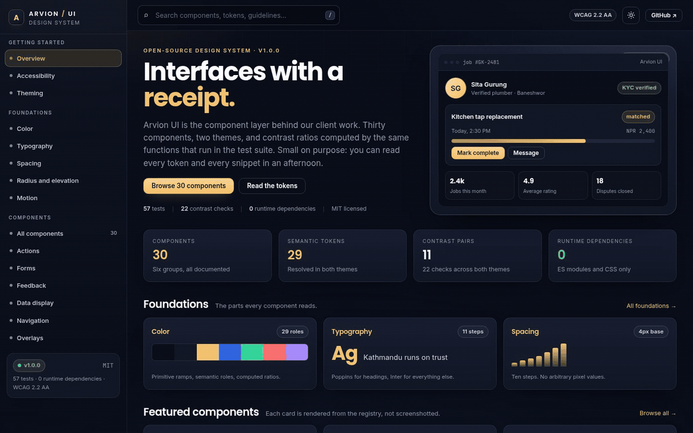
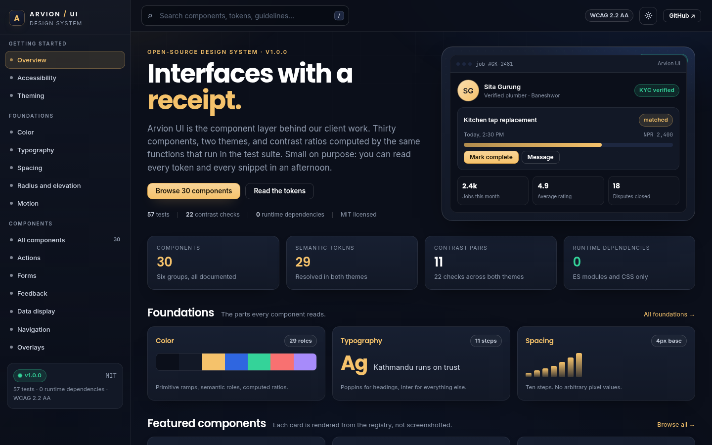
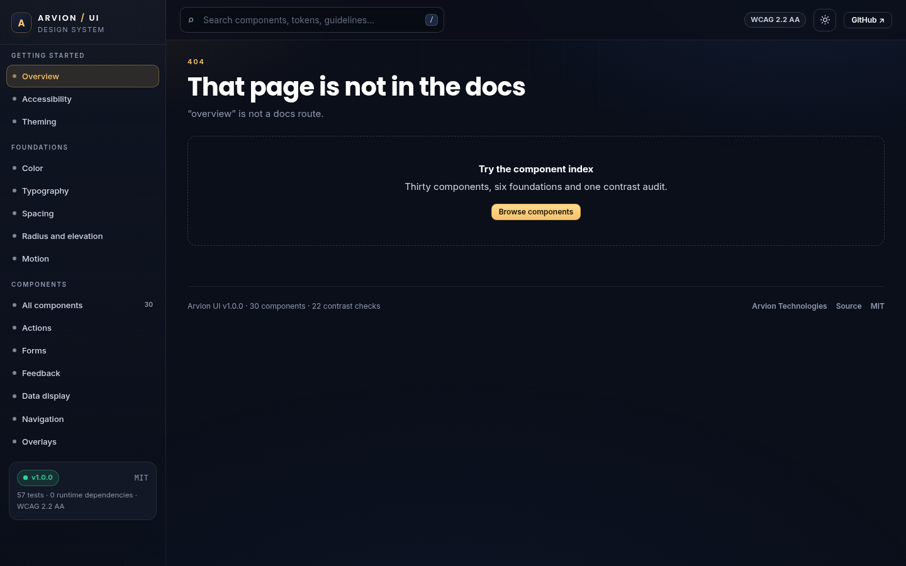

<div align="center">

</div>

<sub>Recorded from the live demo, <a href="docs/demo.mp4">MP4</a> · <a href="docs/screenshot.png">static frame</a></sub>

# Arvion UI

The design system we use on client work, published as a runnable documentation
site. It ships a two-layer token architecture, thirty components, a dark and a
light theme, and a contrast audit that recomputes every promised ratio in the
browser. Nothing is screenshotted: the component previews, token tables and
ratio badges are all rendered from the same ES modules the tests import.

[**Open the live demo**](https://arvion-technology.github.io/labs/demos/design-system/) · [MIT](LICENSE)

---

Most design systems are a package you install and documentation you trust. This
one is deliberately the other way around. The documentation site is the product:
open it, read a component's snippet, toggle the preview to the light theme, and
the contrast number you see is the same number the build fails on if a token
regresses. There are no runtime dependencies and no build step, so the whole
thing is readable in a session.

## What it does

- **A documentation site with search**: sidebar navigation, a ranked search
  index over all thirty components and five foundations, and deep links such as
  `#/components/button` and `#/tokens/color`.
- **Token pages**: colour roles with contrast measured against both the card
  and the page, the primitive ramps they come from, the eleven-step type scale,
  the 4px spacing scale, radii, elevation and four motion curves.
- **Thirty components**: every one has a live preview rendered from its
  copyable HTML snippet, two or three accessibility notes, and usage guidance.
  Preview and snippet come from the same registry entry, so they cannot drift.
- **Dark and light themes**: a theme switch in the top bar, persisted, and an
  independent theme toggle on every component preview so you can check both
  surfaces without leaving the page.
- **A computed contrast audit**: eleven promised pairs per theme, checked at
  load time and printed with the WCAG level each pair reaches. The test suite
  fails if any pair drops below its declared threshold.
- **A generated token stylesheet**: `themeCSS()` emits the semantic custom
  properties for both themes, ready to paste into another project.

## Screenshots

| Documentation overview | Component page |
| --- | --- |
|  |  |

## Architecture

```text
projects/25-design-system
├── src/
│   ├── tokens.js       primitives, semantic roles, type/space/radius/motion scales,
│   │                   CSS-variable generation and the promised contrast pairs
│   ├── contrast.js     WCAG relative luminance, compositing, ratios, grading
│   ├── audit.js        resolves token pairs per theme and runs the contrast maths
│   ├── components.js   registry: 30 components, snippets, a11y notes, search tags
│   ├── search.js       ranked in-memory search over the docs index
│   └── theme.js        stored/OS theme resolution, class + attribute names
├── demo/               static docs site; renders from src, owns no design logic
│   ├── index.html      shell, sidebar, top bar
│   ├── app.js          hash router + page renderers
│   ├── ds.css          docs layout and the component CSS the gallery demonstrates
│   └── arvion.css      shared brand tokens and app shell
├── test/               five node:test suites, 57 cases
└── scripts/            zero-dependency server, screenshot, static checks
```

The dependency direction is one-way: `demo/app.js` imports `src/*`, and `test/*`
imports the same files. No file in `src/` knows the demo exists.

## Quickstart

```bash
git clone https://github.com/arvion-technology/design-system.git
cd design-system
npm test          # 57 tests, no dependencies, Node 20+
npm run demo      # http://localhost:4173/demo/
```

Generate the token stylesheet without installing anything:

```bash
node -e "import('./src/tokens.js').then(m => process.stdout.write(m.themeCSS()))" > tokens.css
```

Screenshots use headless Chromium, which is the only tool outside Node this
repository needs:

```bash
npm run shot      # docs/screenshot.png
npm run shot:2    # docs/screenshot-2.png, the Button page
npm run verify    # unit tests plus static checks on the demo bundle
```

## How it works

**Three token layers, and only one is public.** `PRIMITIVES` holds the raw ink,
gold, blue and status ramps. `THEMES` maps both themes onto twenty-nine semantic
roles, `bg`, `surface`, `text`, `accentText`, `blue`, `focus`, and so on.
`cssVariables()` emits `--arv-color-*`, `--arv-space-*`, `--arv-text-*` and the
rest. Components read the semantic layer only; the emitted CSS never contains a
primitive, which the tests assert by looking for `ink-900`. The reason is
practical: a component that hard-codes `#3a7bff` cannot follow a theme, and
today it is one grep away from being unrecoverable.

**The contrast audit is code, not a spreadsheet.** Every pair the system
promises lives in `A11Y_PAIRS` as two semantic token names and a use. The audit
resolves them through the active theme and runs `contrastRatio()`, WCAG 2.2
relative luminance, with translucent colours composited over the backdrop first,
because a ratio only exists relative to a background. The tests check the maths
against known anchors (black on white is 21:1, `#767676` on white is 4.54:1),
then check that all twenty-two theme/pair combinations pass.

```js
import { auditBothThemes } from "./src/audit.js";

const report = auditBothThemes();
report.summary;
// { total: 22, passing: 22, failing: 0, worst: {...} }
```

**One deliberate change to the brand colour.** The brand blue is `#3a7bff`.
White 13px text on it measures 3.84:1, which fails AA for normal text. The
action fill is therefore `#2f66e0` (5.12:1), the brand hue is still used for
charts and tints, where the same rule does not apply. The docs state this on the
colour page rather than quietly shipping a failing button.

**The light theme exposes a different problem.** Gold at brand strength is
1.6:1 on a white card, so text links use `accentText` (`#7a4d00`, 7.3:1) while
fills keep the brighter gold. That split is why `accent` and `accentText` are
different roles instead of one token with an exception.

**Search is ranked, not filtered.** `search()` scores title exact matches above
title words, above tags, above body text, and only returns records where every
query term matched. The docs route each result to a real page, so typing
"escrow" finds the badge example rather than everything containing the word.
The test suite covers ranking, multi-term queries, case and accent folding, tie
stability and the highlight ranges used by the result list.

**Components are CSS plus small DOM behaviours, not custom elements.** That is a
deliberate limit: snippets stay pasteable HTML with no shadow DOM, no
registration step and no framework. The interactive examples (tabs, dropdown,
switch, modal, toast) are wired in the docs page with the same helpers a
consumer would use, the snippet shows the markup contract, the page shows the
behaviour.

## Tests

```bash
npm test
```

Fifty-seven cases on `node:test`, split by module:

| Suite | What it locks down |
| --- | --- |
| `contrast.test.js` | luminance anchors, compositing, ratio symmetry, grade boundaries, readable label selection, ramp interpolation |
| `tokens.test.js` | theme key parity, every colour parses, brand anchors, type scale order, 4px spacing scale, easings, CSS output, no primitive leakage |
| `components.test.js` | exactly thirty components, group coverage, snippet well-formedness, no remote assets, search records |
| `search.test.js` | ranking, multi-term matching, tag matches, case/accent folding, limits, stable ties, highlight ranges |
| `audit.test.js` | all twenty-two pairs pass in both themes, ratios resolve real token values, focus ring clears 3:1, blue-label decision |

The demo has a second, static gate that checks every local asset reference
resolves, the brand stylesheet is present and no placeholder text ships:

```bash
node scripts/serve-check.mjs
```

## Limitations

- There is no npm package. The repository is the distribution: copy `arvion.css`,
  `demo/ds.css` and `src/tokens.js`, or vendor the emitted token CSS.
- There are no React, Vue or Flutter bindings. The components are HTML and CSS;
  adding a framework adapter would be a separate package and is not pretended
  here.
- The contrast audit covers token pairs, not every composition a product can
  build. It cannot tell you whether the accessible name of your button makes
  sense in context, and it does not test focus order outside the docs page.
- There is no visual-regression suite. The screenshots are a manual check, not
  an automated baseline.
- The demo ships its search index in memory. It is sized for thirty components
  and six foundations; it is not a search engine.

## Project layout

```text
25-design-system/
├── README.md
├── LICENSE, SECURITY.md, CONTRIBUTING.md
├── src/
│   ├── tokens.js       token data + CSS generator + promised pairs
│   ├── contrast.js     WCAG maths, grade, audit helpers
│   ├── audit.js        per-theme audit, token rows for tables
│   ├── components.js   30-component registry and snippets
│   ├── search.js       ranked docs search
│   └── theme.js        theme resolution helpers
├── demo/
│   ├── index.html      docs shell
│   ├── app.js          router and page renderers
│   ├── ds.css          docs layout + gallery component CSS
│   ├── arvion.css      shared brand stylesheet
│   ├── arvion.js       shared runtime helpers
│   └── fonts/          self-hosted Inter and Poppins
├── test/               five node:test suites
├── docs/               the two screenshots above
└── scripts/            serve, screenshot, static checks
```

## Credits

Built by [Arvion Technologies](https://arviontech.net) in Kathmandu. The token
layer is the part we reuse most on client products; this repository is the
cleaned-up version of that file, with the contrast decisions written down
instead of living in someone's memory. MIT licensed.
